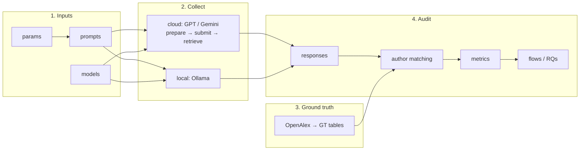

# LLMScholar-Personas

Auditing LLMs as people recommender systems with personas.

## Pipeline



Commands and all arguments: [code/scripts/README.md](code/scripts/README.md). Run sheet: [myruns.md](myruns.md).

## Setup

```bash
conda activate py311_llmscholar
```

API keys are read from the environment variables `OPENAI_API_KEY` and `GEMINI_API_KEY` (needed for params
translation and cloud collection). Store them once in the conda env:

```bash
# run the line, press Enter, paste your OpenAI key (hidden, not saved in the history), press Enter
read -s OPENAI_API_KEY && conda env config vars set OPENAI_API_KEY="$OPENAI_API_KEY" -n py311_llmscholar

# same for the Gemini key
read -s GEMINI_API_KEY && conda env config vars set GEMINI_API_KEY="$GEMINI_API_KEY" -n py311_llmscholar

# re-activate to load them, then check
conda deactivate && conda activate py311_llmscholar
conda env config vars list -n py311_llmscholar
```

Type the lines as they are: `$OPENAI_API_KEY` is filled in by the shell with the key you pasted.

To remove one: `conda env config vars unset OPENAI_API_KEY -n py311_llmscholar`.

## Run

Scripts run from any folder (default paths resolve from the project root).

**1. Inputs** → `data/context/<language>/`, `data/models/models.txt`

```bash
python code/scripts/batch_input_params.py -l english
python code/scripts/batch_input_prompts.py
python code/scripts/batch_input_models.py
```

**2. Collect** → `data/responses/results_<api>_<language>/`

```bash
# GPT / Gemini (Batch API, answers within 24h)
python code/scripts/batch_collect_cloud_prepare.py  --models gpt-4_1-nano-2025-04-14
python code/scripts/batch_collect_cloud_submit.py   --models gpt-4_1-nano-2025-04-14
python code/scripts/batch_collect_cloud_retrieve.py --models gpt-4_1-nano-2025-04-14

# Ollama (local servers)
python code/scripts/batch_collect_local.py --models gemma3-4b-it-q4_K_M --nr_servers 4
```

**3. Ground truth** → `results/groundtruth/`

```bash
bash code/scripts/run_gt_pipeline.sh
```

**4. Audit** → `results/`

```bash
bash code/scripts/run_responses_pipeline.sh     # tag responses and recommendations
bash code/scripts/run_matching_pipeline.sh      # match recommended names to OpenAlex authors
bash code/scripts/run_metrics_pipeline.sh       # metrics, flows, RQ1, RQ2
```

**Variants**: the same pipeline with other settings (e.g. Jaro-Winkler 0.97), in folders named after the variant:

```bash
python code/scripts/configure_variant.py create jw097 --set matching.jw_full=0.97
bash code/scripts/run_metrics_pipeline.sh -v jw097          # configure_variant.py show jw097 lists every step
```

Notebooks (`code/notebooks/`): `0_gt`, `1_responses_tags`, `2_matching_stats`, `3_metrics`,
`4_research_questions`, `5_flows`.

## Folders

```
.
├── code/
│   ├── libs/            library code
│   │   ├── prompt/        prompt generation
│   │   ├── llm/           model names, API callers, response store
│   │   ├── groundtruth/   OpenAlex GT tables
│   │   ├── demographics/  perceived gender / ethnicity
│   │   ├── responses/     parsing and tagging LLM output
│   │   ├── annotation/    manual validation
│   │   ├── matching/      recommended names → OpenAlex authors
│   │   ├── metrics/       technical and social metrics
│   │   ├── analysis/      RQ statistics
│   │   ├── viz/           figures
│   │   └── utils/         constants, io, logs, CLI helpers
│   ├── scripts/         batch_input_*, batch_collect_*, batch_*, run_*_pipeline.sh
│   ├── notebooks/       figures and checks
│   ├── tests/           python -m unittest discover -s code/tests
│   └── tools/           annotation tool
├── data/
│   ├── context/         parameters and prompts per language
│   ├── models/          models.txt, metadata.json
│   ├── responses/       raw LLM responses
│   ├── mappings/
│   └── openalex_*.duckdb
├── results/             groundtruth, matching, metrics, ...
├── plots/               a folder per variant
├── logs/                one log per script run
└── tmp/                 scratch and smoke tests (git-ignored)
```
