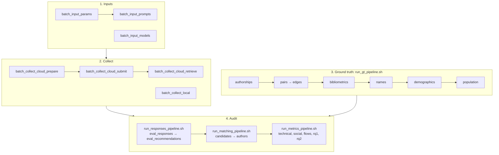

# Batch Processing Scripts

Scripts run from any folder (no `PYTHONPATH`: `_bootstrap.py` adds `code/libs`). Env: `py311_llmscholar`.



`configure_analysis.py` sets the analysis config (early settings after the GT bibliometrics, late settings
after the first metrics); the annotation scripts validate the tags and the matching (see below).

## Variants

A variant = a name you choose + a full analysis config. `main` is `config/analysis.yaml`; every other variant is
`config/variants/<name>.yaml` (header: `base`, `differs` = the settings changed, e.g. `jwfull=0.97, dup=yes`).
Its outputs go to folders named after it. A stage whose settings it does not change is skipped: the variant reads
main's GT population or author matching.

```bash
python code/scripts/configure_variant.py create jw097 --set matching.jw_full=0.97     # or a code: jwfull=0.97
python code/scripts/configure_variant.py create pf02 --set pf=0.2,0.8
python code/scripts/configure_variant.py list
python code/scripts/configure_variant.py show jw097          # settings, folders, commands to run
bash code/scripts/run_matching_pipeline.sh -s authors -v jw097
bash code/scripts/run_metrics_pipeline.sh -v jw097
```

| Stage | Folder | Own folder if the variant changes |
|---|---|---|
| GT population (A.4) | `groundtruth/population/<name>/` | seniority, field share, gender, ethnicity, prominence |
| author matching (B.6b) | `matching/authors/<name>/` | seniority, field share, Jaro-Winkler, seed |
| metrics, RQs | `metrics/<name>/` | always |
| plots (notebooks) | `plots/<name>/` | always (`VARIANT = '<name>'`) |

Shared by every variant: the GT tables of A.0–A.3 (`groundtruth/authorships, coauthor_*, authors, names,
demographics`) and the matching candidates (B.6a; `candidates_floor` and `fuzzy_all` cannot change).
Edit a variant with `configure_analysis.py --config config/variants/<name>.yaml` (its header is kept).

## Inputs

| Script | Writes |
|---|---|
| `batch_input_params.py` | `data/context/<language>/{instructions,locations,input}.json` (non-English: translated with OpenAI) |
| `batch_input_prompts.py` | `data/context/<language>/all_params_and_prompts.json` + `all_prompts.txt` |
| `batch_input_models.py` | `data/models/models.txt` from `data/models/metadata.json` |

```bash
python code/scripts/batch_input_params.py -l english
python code/scripts/batch_input_prompts.py
python code/scripts/batch_input_models.py
python code/scripts/batch_input_models.py --apis ollama --output tmp/models_ollama.txt
```

| Script | Argument | Default | Description |
|---|---|---|---|
| params | `-l, --language` | english | target language |
| params | `-o, --output-dir` | `data/context` | |
| prompts | `-l, --languages` | all | |
| prompts | `-o, --output-dir` | `data/context` | folder with `<language>/` parameters |
| prompts | `-c, --combination_id` | none | print this combination |
| prompts | `--overwrite` | off | rewrite existing prompt files |
| models | `--models_metadata_file` | `data/models/metadata.json` | |
| models | `--output` | `data/models/models.txt` | |
| models | `--apis` | all | only gpt / gemini / ollama models |
| models | `--overwrite` | off | replace a list with other models |

Notes:
- Prompt `id` = position of the combination = key of the response files. Never change the order.
- Re-translating (params `-l german|spanish`) changes those prompts: only for new parameters.
- `metadata.json`: key = model slug; `api` (gpt | gemini | ollama) and `api_name` (name the API expects),
  with key = `model_slug(api_name)`.
- API keys: environment variables `OPENAI_API_KEY` / `GEMINI_API_KEY` (how to set them: main README, *Setup*).

## Collect

Per model and language, appends to `data/responses/results_<api>_<language>/<api>_<language>_<model>.json`.
Resumable: only missing runs are requested. Models of another API are skipped.

### Cloud (GPT, Gemini)

| Script | Does |
|---|---|
| `batch_collect_cloud_prepare.py` | writes one requests file per run, with the prompts still needed |
| `batch_collect_cloud_submit.py` | uploads new requests files and starts the batch jobs |
| `batch_collect_cloud_retrieve.py` | merges finished jobs (`_batches/done/`), moves failed ones to `_batches/failed/` |

```bash
python code/scripts/batch_collect_cloud_prepare.py  --models gpt-4_1-nano-2025-04-14
python code/scripts/batch_collect_cloud_submit.py   --models gpt-4_1-nano-2025-04-14
python code/scripts/batch_collect_cloud_retrieve.py --models gpt-4_1-nano-2025-04-14
```

Re-run retrieve until nothing is open; then prepare → submit → retrieve again if prompts are still missing.
`prepare --overwrite` rewrites requests files not yet submitted.

### Local (Ollama)

`batch_collect_local.py`: sends prompts to running Ollama servers (consecutive ports), pulls missing models,
saves each answer at once, retries failed prompts.

```bash
python code/scripts/batch_collect_local.py --models gemma3-4b-it-q4_K_M --nr_servers 4 --max_processes 8
parallel -j 2 python code/scripts/batch_collect_local.py --models {} :::: tmp/models_ollama.txt
```

| Argument | Default | Description |
|---|---|---|
| `--host` | localhost | |
| `--first_port` | 11434 | port of the first server |
| `--nr_servers` | 1 | servers on consecutive ports |
| `--max_processes` | 4 | worker processes |
| `--timeout` | 600 | seconds per request |
| `--max_output_tokens` | server default | Ollama `num_predict` |
| `--context_window` | server default | Ollama `num_ctx` |
| `--num_thread` | server default | Ollama `num_thread` |
| `--max_attempts` | 3 | rounds per run for failed prompts |
| `--retry_wait` | 60 | seconds between rounds |
| `--pull_only` | off | only pull missing models |

### Shared arguments

| Argument | Default | Description |
|---|---|---|
| `--models` / `--models_file` | all of `data/models/models.txt` | model slugs |
| `--languages` | english spanish german | |
| `--models_metadata_file` | `data/models/metadata.json` | `api` and `api_name` per model |
| `--responses_dir` | `data/responses` | |
| `--context_dir` | `data/context` | prompts (prepare, local) |
| `--repetitions` | 10 | runs per prompt (prepare, local) |
| `--limit_prompts` | all | first N prompts (smoke tests) |
| `--log_dir` | `logs` | |

Smoke test: `--languages english --repetitions 1 --limit_prompts 3 --responses_dir tmp/smoke/responses`.

## Audit pipeline

All audit scripts read from `data/` and write to `results/`. Default paths are resolved from the project root,
so scripts run **from any folder** (project root, `code/scripts`, ...) and need no `PYTHONPATH`
(`_bootstrap.py` adds `code/libs`). Every path can be overridden from the command line.
Use the `py311_llmscholar` conda environment.

### Running everything — `run_responses_pipeline.sh`

Runs steps B.1–B.3 (summary → recommendations) with GNU parallel, one process per model.

```bash
conda activate py311_llmscholar
bash code/scripts/run_responses_pipeline.sh                        # all steps, all models, 10 jobs
bash code/scripts/run_responses_pipeline.sh -j 20 -s summary       # one step: summary | recommendations
bash code/scripts/run_responses_pipeline.sh -x "--overwrite"       # recompute existing files
bash code/scripts/run_responses_pipeline.sh -r tmp/smoke -l tmp/smoke/logs -x "--limit_prompts 5"   # smoke test
```

Options: `-j` jobs (10), `-m` models file (`data/models/models.txt`), `-s` step (`all`), `-p` python executable,
`-r` results root (`results/`), `-l` logs folder (`logs/`), `-x` extra arguments for the per-model scripts.
If a step has failed models it stops and prints the `--resume-failed` command that re-runs only those.


### Checking the latest runs — `check_eval_runs.sh`

Read-only. For every model it takes the newest log of `batch_eval_responses.py` and of
`batch_eval_recommendations.py` (only files directly in `logs/`; sub-folders such as `logs/2025/` are
ignored) and reports models whose step FAILED, is UNFINISHED or MISSING, whose recommendations log is older
than its responses log, or whose stored tags in `results/*_metadata/<model>.parquet` are not current tag names
(e.g. written before a rename). Prints the commands that re-run only those models; exit code 1 if anything
is wrong.

```bash
bash code/scripts/check_eval_runs.sh          # problems only
bash code/scripts/check_eval_runs.sh -v       # one line per model
```

### Logging

- Every script run: `logs/<timestamp>_<script>_<params>.log`
  (e.g. `2026-11-04-23:10_responses_summary_gpt-4_1-nano-2025-04-14.log`; `params` = model, languages if a subset,
  `limit<N>` for smoke tests). Starts with the full command and all arguments; failures are logged with tracebacks.
- Every GNU parallel step of the runner: `logs/<timestamp>_<step>_<models file>.joblog`
  (e.g. `2026-11-04-23:10_responses_summary_models.joblog`; column `Exitval` must be 0 for every model).
- Running GNU parallel by hand: it writes a joblog only if you pass `--joblog <file>`.

### Running a single script

```bash
python code/scripts/batch_eval_responses.py --models gpt-4_1-nano-2025-04-14     # from the project root
cd code/scripts && python batch_eval_responses.py --models gpt-4_1-nano-2025-04-14  # or from code/scripts
```

### Tags (multi-label)

Responses and recommendations are tagged with **every** tag that applies. Each output file has a joined column
(`response_tags` / `rec_tags`, e.g. `title_removed|repetition_removed`) and one boolean column per tag
(`response_<tag>` / `rec_<tag>`). "Valid" is defined later as a combination of tags, after reading the report.

### Step B.1-2 — `batch_eval_responses.py`

Reads every raw response, decodes it, and tags it (rules in `libs/responses/taxonomy.py`).
A response with >= 1 named recommendation gets every **issue** tag that applies, or `correct` (alone) if none
applies; a response without names gets exactly one **failure** tag. Recommendations are extracted from every
response with names, whatever its tags (e.g. from the list inside a `wrapped` object).

| Group | Tag | Meaning |
|---|---|---|
| — | `correct` | none of the other tags apply: a strict JSON array of recommendations, no disclaimer (always alone; completeness is per recommendation, see B.3) |
| issue | `python_literal` | python syntax instead of JSON (single quotes, `True`/`None`, trailing commas) |
| issue | `embedded` | JSON surrounded by prose (`"Here you go: [...]"`) |
| issue | `truncated` | cut off (e.g. token budget hit mid-record): parsed up to the last complete record, trailing partial entry discarded |
| issue | `wrapped` | JSON root is an object (`{"candidates": [...]}`), not the requested array |
| issue | `toy` | names disclaimed as illustrative / fictional (`toy_keyword` records the match) |
| failure | `empty` | no content (empty string or whitespace only) |
| failure | `empty_list` | an object wrapping only empty lists, e.g. `{"candidates": []}` |
| failure | `refused` | declines to recommend (natural-language justification, no names) |
| failure | `invalid` | API error, unparsable / broken JSON, `[]`, no person objects, or only template names |

JSON broken anywhere other than at the end (e.g. a missing comma) is not repaired: it is `invalid`.
Writes `results/responses_metadata/<model>.parquet` (one row per response, with tags,
`parse_method`, `json_root`, counts of persons / named / complete persons, tokens, finish reason, errors).

| Argument | Default | Description |
|---|---|---|
| `--responses_dir` | `data/responses` | Folder with `results_<source>_<language>/` |
| `--context_dir` | `data/context` | Prompt parameters per language (maps ES/DE values back to English) |
| `--collection_dates_file` | `data/models/collection_dates.json` | Dates for sources without timestamps (Gemini) |
| `--models_file` | `data/models/models.txt` | One model per line |
| `--models` | all | Models to process (one with GNU parallel: `--models {}`) |
| `--languages` | all | Subset of languages |
| `--limit_prompts` | none | Only the first N prompts per file (smoke tests) |
| `--overwrite` | off | Recompute existing files |
| `--output_dir` | `results/responses_metadata` | Output folder (`<model>.parquet`) |
| `--log_dir` | `logs` | Log folder |

### Step B.3 — `batch_eval_recommendations.py`

Tags every recommended person (rules in `libs/responses/recommendations.py`):

| Tag | Meaning |
|---|---|
| `correct` | none of the other tags apply (always alone) |
| `title_removed` | honorifics/degrees removed (Dr., Prof., PhD) |
| `repetition_removed` | both parts given, one repeated inside the other (`"John Smith"` / `"Smith"`): repetition removed |
| `split` | only one part given, with > 1 word: split into first + last name |
| `initials_name` | first name is initials only (`"M."` / `"Smith"`) |
| `initials_lastname` | last name is initials only (`"Michael"` / `"G."`) |
| `initials` | both first and last name are initials only (`"S. M."` / `"D."`) |
| `placeholder` | template instead of a name (`"Candidate 1"`, `"Last Name"`); always alone |
| `invalid` | no usable name (missing, or a single word only) |

Stores the recommendations of every response with named recommendations (whatever its tags). Per recommendation: `missing_fields` / `is_complete` (non-name
requested keys absent from the person's object: current_affiliations, areas_of_research_or_work, reason, source; a present key counts whatever its value, also empty), `name_fix` (how a name was split / fixed), `name_key` (name tokens without case/accents,
any order; used later by the duplicates metric — duplicates are not a tag). Only the names are used by the audit, but nothing the
LLM returned is lost: the requested metadata is in `affiliations`, `areas`, `reason`, `source_url`, additional keys
are listed in `extra_fields`, and the full original object of every person is kept in `record_json`.
Writes `results/recommendations_metadata/<model>.parquet`.
Same arguments as above, plus `--responses_metadata_dir`.

### Inspecting the tags — `code/notebooks/responses_tags.ipynb`

Plots the distribution of tag combinations (no batch report): responses and recommendations per model, and for
all models (mean of the model shares, every model weighs equally, with a 95% hierarchical bootstrap CI: models,
then configurations within models; `tag_stats.model_mean_shares`, constants `DEFAULT_BOOTSTRAP_SAMPLES`,
`DEFAULT_CONFIDENCE`, `DEFAULT_SEED`). Valid combinations
(all tags in the valid set; defaults `DEFAULT_VALID_RESPONSE_TAGS` / `DEFAULT_VALID_REC_TAGS` in `constants.py`,
overridable in the notebook) are green, the others red and hatched. Plots: `results/plots/<variant>/tags_*.{png,pdf}`.
Paper figures (`tags_responses_paper`, `tags_recommendations_paper`): per-model panel (4/5) + overall panel (1/5),
both vertical with a shared 0–100 axis, A4 width × 2.9 in; models sorted by valid share (desc.); short model labels
(`viz/labels.py`, rules in `viz/constants.MODEL_LABEL_RULES`, checked to be unique) and short tag labels
(`viz/constants.TAGS_SHORT_LABELS`, e.g. `py_lit+wrap+toy`; define them in the caption); $N_m$ and $N_r$ annotated
inside the overall panel (no per-model title). Each paper cell prints the figure caption (`viz/captions.py`). Rule for all plots: titles only in PNG, never in PDF (PNG titles
include $N_m$ / $N_r$). Visual constants: `viz/constants.py` (imported as `viscons`). Style (`viz/style.apply_style()`, called by the notebook): seaborn `ticks` + `paper`
context × 0.75 (figures drawn at print size: ticks ~6.6 pt, labels ~7 pt), Helvetica-like TrueType font
(Liberation Sans here), fonts embedded as TrueType (Type 42) in PDFs for submission checkers.

### Order

`batch_eval_responses.py` → `batch_eval_recommendations.py` (needs the summary); `run_responses_pipeline.sh` runs
them in this order. Then open `code/notebooks/responses_tags.ipynb`.

### Manual validation of the tags — `batch_annotation_sample.py`, `code/tools/annotation_tool.html`, `batch_annotation_evaluate.py`

Blind check of the inferred tags (the annotator never sees them):

```bash
python code/scripts/batch_annotation_sample.py --task responses          # or --task recommendations
python code/scripts/serve_annotation_tool.py                             # on the server; Ctrl+C to stop
# open http://localhost:8765 in your local browser (VS Code forwards the port; or: ssh -L 8765:localhost:8765 <server>)
# choose the task, annotate: every item is saved to results/annotations/annotation_<task>_<annotator>.csv
python code/scripts/batch_annotation_evaluate.py --task responses
```

Offline alternative: open `code/tools/annotation_tool.html` directly, load the items file, and put the exported
CSV into `results/annotations/`. The server binds to 127.0.0.1 only and never serves the key file.

- Sample: up to `--per_stratum` (20) items per inferred tag combination (rare ones all checked), at most
  `--max_items` (400), seed 42. Items file = codebook + content only; key file = inferred tags (evaluation only).
  An existing sample is never overwritten (annotations refer to its item ids) unless `--overwrite`.
- Tool: one item per screen, tick all tags that apply (keys 1–9, 0, -, =), "unsure", notes, for recommendations
  the first / last name as you would record them; order shuffled per annotator; autosaved in the browser.
  Responses: the prompt is collapsed (requested k in its header) and a **Checks** panel shows facts computed in the
  browser with `JSON.parse`, independently of the pipeline (never its labels or tag names): whether the raw / cleaned
  text parses, the error location (end of text = truncation, or middle), a JSON block inside surrounding text,
  the root (array / object), the number of person records vs k, and the missing requested fields per record.
  Report it in the paper as "annotators were assisted by a JSON syntax check".
  Responses also ask for the **number of recommended people** (compared with the pipeline's count of person records,
  i.e. `k_returned` of `k_ratio`). Recommendations have an **extra_missing** checkbox (key `m`): a requested
  non-name key is absent (compared with the pipeline's `missing_fields`). Answers saved before a checkbox existed keep
  it empty (= not answered, never "no"); "Next unannotated" also visits them. To add new codebook fields to an existing sample without changing its items:
  `python code/scripts/batch_annotation_sample.py --task responses --refresh_codebook`.
- Evaluation (`results/annotations/annotation_<task>_eval_<table>.csv`): `summary` (exact match of tag sets,
  accuracy of the valid / not valid decision, name match, extra_missing match), `tags` (precision / recall / F1 per tag), `agreement`
  (Krippendorff's alpha per tag, >= 2 annotators), `disagreements` (items to inspect). Gold = majority of
  non-unsure annotators; tied items are excluded and counted.
- Verification tasks (`--task matching`, `--task authors`; `libs/annotation/verification.py`): the pipeline's
  output is shown and checked against OpenAlex (links are clickable; one label per group). `matching`: distinct valid
  recommended names x field x seniority, stratified by match outcome (`<rule>|linked`, `<rule>|name`, `none`);
  `authors`: GT memberships, stratified by field x seniority (field, seniority, country, merged profile). The
  evaluation writes `rates` (share of every label per stratum with Wilson CIs, and overall re-weighted to the
  stratum sizes: e.g. precision of the matches, share of missed matches) and `agreement` (per label group).

### Ground truth (step A) — `run_gt_pipeline.sh`, `batch_gt_*.py`

OpenAlex (`data/openalex_20260923.duckdb`) is opened **read-only**; outputs go to `results/groundtruth/`, scratch /
spill space to `<project>/tmp/` (git-ignored). Code: `libs/groundtruth/`, `libs/demographics/`.

```bash
# on the shared server: always inside a capped scope (only this pipeline can be killed, never the server)
systemd-run --user --scope -p MemoryMax=64G -p MemorySwapMax=0 -p CPUQuota=1400% \
    bash code/scripts/run_gt_pipeline.sh                    # all steps, in order; re-run the same command to resume
bash code/scripts/run_gt_pipeline.sh -s bibliometrics       # one step
bash code/scripts/run_gt_pipeline.sh -h                     # all options
```

DuckDB steps run one chunk / bucket at a time (DuckDB is multi-threaded: `-d 1` job × `-t 12` threads × `-m 40GB`);
the Python-bound steps run in parallel with GNU parallel (`-j 4` jobs × `-c 3` threads). Everything is resumable:
outputs are written to a temporary name and renamed when complete, finished chunks / buckets are skipped, and
demographics continues inside a name shard from its last stored part (every 20k names).

| Step | Script | Output | What it does |
|---|---|---|---|
| A.0 | `batch_gt_authorships.py` | `authorships/chunk=<c>/bucket=<b>/` | the only scan of `works`, in chunks of 2M rows (together the whole table). Works kept: not paratext, not retracted, not xpac, year 1900–2025. One row per (author, work): year, citations, team size, primary-topic field / subfield. The lookup every later step reads |
| A.0b | `batch_gt_pairs.py` | `coauthor_pairs/chunk=<c>/bucket=<b>/` | coauthor pairs per chunk (self-join inside the chunk; works with ≤ 100 authors). Intermediate, ~1–3 s per chunk |
| A.1a | `batch_gt_edges.py` | `coauthor_edges/bucket-<bb>.parquet` | **the coauthorship edge list**: author_id, coauthor_id, n_shared_works, newman_weight (Σ 1/(team−1)), min_team, first/last year. Used for the coauthor counts (A.1) and the network (A.5) |
| A.1 | `batch_gt_bibliometrics.py` | `authors/bucket-<bb>.parquet` | per author: first/last year, # works, # works with a primary topic, # citations, h / i10 / e index, # unique coauthors (rows in the edge list), works per prompt field, OpenAlex stats, latest affiliation country, is_person |
| A.2 | `batch_gt_names.py` | `names/bucket-<bb>.parquet` | name index over ALL authors (display + alternative names, cleaned with `utils/text.py`): `name_key` (= recommendations' `name_key`), `name_key_short`, `name_norm`, `first_norm` / `last_norm` (OpenAlex has full names only: split like the recommendations), `initials_key`, is_person |
| A.3 | `batch_gt_demographics.py --stage keys / gender / ethnicity / merge` | `demographics/bucket-<bb>.parquet` (+ `keys/`, `gender/first_names.parquet`, `ethnicity/shard-<ss>.parquet`) | people with ≥ 1 field work: **probabilities only** — p_female (nomquamgender, first name), p_asian … p_other (raceBERT, full name). Both models run **once per distinct name over all buckets** (gender: one process, ~2 min; raceBERT: 40.4M authors → 31.3M names, sorted by length, in 64 shards); `-C DIR` reuses the probabilities of an earlier demographics output by name. Slowest step (CPU) |
| A.4 | `batch_gt_population.py` | `gt_authors`, `gt_members`, `gt_shares`, `gt_cutoffs` | field shares (`share_<field>`) and membership (`--min_field_share`, default 0 = any work), academic age, seniority, gender / ethnicity labels (`--gender_uncertainty` 0.1, `--ethnicity_min_prob` 0.5), L/M/H bins, top 5 %, GT shares. Cheap: re-run with other thresholds any time |
| A.5 | `batch_gt_coauthorship.py` | `coauthorship/coauthorship_<ids>.parquet` | network among given authors (e.g. the factual recommended ones): edges of the edge list with both ends in the set |

**Memory**: DuckDB takes 80 % of the RAM per process unless limited; every script has bounded defaults
(`--threads 12 --memory_limit 40GB --temp_dir <project>/tmp/duckdb`).

Smoke test without touching the full database: build a mini copy (a few thousand works and their authors) in
`<project>/tmp/smoke/` and run `run_gt_pipeline.sh -o tmp/smoke/mini_openalex.duckdb -n 4 -k 5000 -r tmp/smoke -l tmp/smoke/logs` (`-r` = results root: the ground truth goes to `tmp/smoke/groundtruth/`).

### GT descriptives — `code/notebooks/0_gt.ipynb`

No script: the notebook aggregates the A.1 / A.4 outputs in DuckDB (`libs/groundtruth/stats.py`; 4 threads / 16 GB,
`cons.GT_STATS_*`; the big tables are never loaded into pandas) and plots with `libs/viz/gt_plots.py`. Aggregated
tables are cached in `groundtruth/population/<variant>/descriptives/` and recomputed when an A.4 file is newer. Sections: population (funnel,
scholars per field x seniority, field overlap), academic age with the seniority cut-offs, bibliometrics (per field x
seniority, by perceived gender, by perceived ethnicity), perceived gender / ethnicity (unknown reasons, p_female and
each raceBERT probability with the config thresholds, composition = the parity targets), countries (+ the prompt
countries), prominence (L / M / H ranges, composition, perceived gender / ethnicity inside each class and the top x %).
Per field only (no subfield level in the GT). Plots `plots/<variant>/gt_*`.

### Author matching (step B.6) — `run_matching_pipeline.sh`, `batch_match_candidates.py`, `batch_match_authors.py`

Needs B.3 and A.1 / A.2. Code: `libs/matching/` (the factuality metric is computed later from its `matched_*` columns). Two steps, like probabilities → labels in A.3 / A.4:

| Step | Script | Output | What it does |
|---|---|---|---|
| B.6a | `batch_match_candidates.py --stage rec_names / exact / fuzzy_recs / oa_tokens / fuzzy / merge` | `matching/candidates/bucket-<bb>.parquet` | OpenAlex people (all of OpenAlex) per distinct recommended name, with every rule: `exact_display`, `exact_alternative`, `short`, `initials`, and Jaro–Winkler `jw_full` / `jw_first` / `jw_last` (as written or flipped; OpenAlex names containing the recommended surname token; stored if ≥ `-f` 0.90; by default only for names without a stricter match). Heavy, once |
| B.6b | `batch_match_authors.py` | `matching/authors/main/<model>.parquet` (variants: `matching/authors/<variant>/`) | per recommendation: strictest rule with a match (`match_rule`), candidates of every rule, `n_name` / `n_name_field` / `n_name_seniority` / `n_author`, `matched_*`, `author_id` (seeded random among the n_author people), else `matched_author_field` / `matched_author_seniority` with their id when only one of the two sets is non-empty. Thresholds (fuzzy, provisional: both parts `--jw_first` / `--jw_last` ≥ 0.90, `--jw_full` at the floor; `--min_field_share`, `--seniority_definition three/single`, `--junior_max` / `--senior_min` / `--single_cutoff`) recorded in `_params.json`; other thresholds → another variant (`run_matching_pipeline.sh -V <name> -a "<args>"`) |

### Analysis config — `configure_analysis.py`

Every analysis decision in one YAML file: valid response / recommendation tags, seniority (reference year,
junior ≤, senior ≥, single cut-off, definition for matching), minimum field share, perceived gender (cut points on
p_female + one label per interval, any number of classes), ethnicity minimum probability, prominence bins and top
group, author-matching thresholds (fuzzy, seed, candidate floor). `config/analysis.yaml` (full runs) and
`config/analysis_smoke.yaml` (smoke tests), created by the wizard; once a file exists it is loaded as it is.

Two phases. **Early** settings are needed to build the ground truth and the matching candidates (seniority, field
share, L/M/H bins, top percentile, candidate floor); **late** settings are decided after looking at the data and the
metrics (valid tags, gender / ethnicity thresholds, social settings, Jaro-Winkler thresholds). Until reviewed, the
late settings hold provisional defaults (marked in the YAML): the pipeline runs with them, but the research questions
(`run_metrics_pipeline.sh -s rq1,rq2`, notebook 4) refuse to run. Reviewing them lists the steps to re-run. The
Jaro-Winkler thresholds can never go below the early `candidates_floor`.

```bash
python code/scripts/configure_analysis.py --phase early      # before the GT (config/analysis.yaml)
python code/scripts/configure_analysis.py --phase late       # after the metrics, before the RQs
python code/scripts/configure_analysis.py --config config/analysis_smoke.yaml   # every setting (Enter keeps, ? explains, b back, q quit)
python code/scripts/configure_analysis.py --show                                # print config/analysis.yaml
```

Scripts take `--config`; options given on the command line win (robustness variants). The runners
(`run_gt_pipeline.sh` population, `run_matching_pipeline.sh`, `run_metrics_pipeline.sh`) take `-y FILE`; if the
file is missing they start the wizard (in a terminal) or stop.

### Metrics (steps 7–8) — `run_metrics_pipeline.sh`, `batch_metrics.py`

Code: `libs/metrics/technical.py`. Per model: `metrics/<variant>/config/<model>.parquet` (validity, refusals,
behaviour / format / recommendation consistency) and `metrics/<variant>/response/<model>.parquet` (outcome, k ratio,
duplicates, factuality at 4 levels on the unique valid names). Variant `main` by default; robustness checks:
`-V robustness/<check> -a "--keep_duplicates"` (or `--order_sensitive_keys`, `--consistency_all_runs`).

### Social metrics (step 9) — `batch_social_metrics.py` (`run_metrics_pipeline.sh -s social`)

Code: `libs/metrics/social.py`. Per response, on the matched authors of its unique valid names: parity (1 − TV to
the GT target, `config: social.parity_target`), diversity (normalised entropy) and unknown share for gender,
ethnicity, location, productivity, influence, collaboration; popularity (top group by works / citations);
connectedness (coauthorship components); similarity (PCA cosine). `social.include_unknown` (config) decides whether
'unknown' is a class. Outputs `metrics/<variant>/social/<model>.parquet` and `social_gaps/<model>.parquet`.

**Size-adjusted** (every social metric): `<metric>_adj = observed − expected`, expected = the mean for a random list
of the same size n from the GT of the requested field × seniority (0 = like random). Expected values: step
`expected` (`batch_social_expected.py`, `libs/metrics/expected.py`, ~4 min) → `metrics/<variant>/social_expected/`;
the social step needs it. RQ1 / RQ2 run on raw and adjusted metrics (`--metrics all social_adj`); notebooks 3 and 4:
`ADJUSTED = True` plots the adjusted ones (set names → `<name>_adj`, e.g. `paper_adj`); their files end in `_adj`,
next to the raw ones: `rq1_omega2_paper_bar.pdf` / `rq1_omega2_paper_bar_adj.pdf`, `metrics_paper_models_adj.pdf`.

| Metric | Expected value |
|---|---|
| parity, diversity | random labels with the GT class shares (10,000 lists per n) |
| popularity | the target's top share (no simulation) |
| connectedness | 1,000 random lists of real members + their coauthor edges |
| similarity | mean pairwise cosine of 5,000 random members (same for every n) |

### Metric figures — `code/notebooks/3_metrics.ipynb`

All notebook plots go to `results/plots/<VARIANT>/` (set `VARIANT` in the notebook, as for `metrics/<VARIANT>/`).

One function for every bar figure: `viz/metric_plots.plot_metric_bars(summary.estimate(configs, rows, metrics), rows,
metrics)` (`libs/metrics/summary.py`). Rows: `model_rows(models)`, `attribute_rows(['access', 'size', 'reasoning',
'origin'])` or `prompt_rows([...])` (persona variables in one colour, context variables in another); columns:
`select_metrics('all' | 'technical' | 'factuality' | 'social' | a subgroup such as 'consistency' | [keys])`.
Unit = configuration (response metrics averaged within it). CIs: a model row bootstraps its configurations; any other
row is the mean of its models (models weigh equally) with a hierarchical bootstrap (models, then configurations).
Bold = best within a group of rows on the displayed (rounded) values.

### Research questions — `batch_rq1.py`, `batch_rq2.py`, `code/notebooks/4_research_questions.ipynb`

RQ1 (`run_metrics_pipeline.sh -s rq1`, one process per metric): partial ω² (type-II ANOVA) and Shapley R² of the
model and of every configuration variable on each metric, cluster-bootstrap CIs over models →
`metrics/<variant>/rq1/<metric>.parquet`. Options for the RQ scripts via `-q`, e.g. `-q "--n_boot 200 --metrics factuality"`.

Flows (`run_metrics_pipeline.sh -s flows`, appendix figures in `code/notebooks/5_flows.ipynb`): per model, the people
table (valid response × factual person, with the prompt variables and the person's GT attributes) →
`metrics/<variant>/flows/<model>.parquet`; figures: one prompt variable vs the person attributes (or the reverse), any prompt variable or model characteristic → person attribute is a
cross-tab in the notebook, plus the location drift (prompted location → the people's country).

RQ2 (`run_metrics_pipeline.sh -s rq2`, one process per metric): per value of every configuration variable, the
estimated marginal mean and its deviation from the grand mean (weighted effect coding, same model as RQ1),
cluster-bootstrap CIs over models, plus the contrast vs a reference value (`cons.RQ2_REFERENCE_LEVELS`) and R² /
adjusted R² / ΔR² (LLM) → `metrics/<variant>/rq2/<metric>.parquet`.

RQ3 (no script; notebook only): per model, technical score = validity + (1 − refusals) + (1 − duplicates) + the
4 factualities, social score = the 6 parities (`cons.RQ3_*_METRICS`), from the configuration table; scatter with
quadrants split at the model medians (`relative`) or at half of each axis maximum (`absolute`).

### Tests

```bash
# from the project root
python -m unittest discover -s code/tests -v
```

The previous parser (`batch_parse_results.py`) is kept in `_old/` for reference only.
